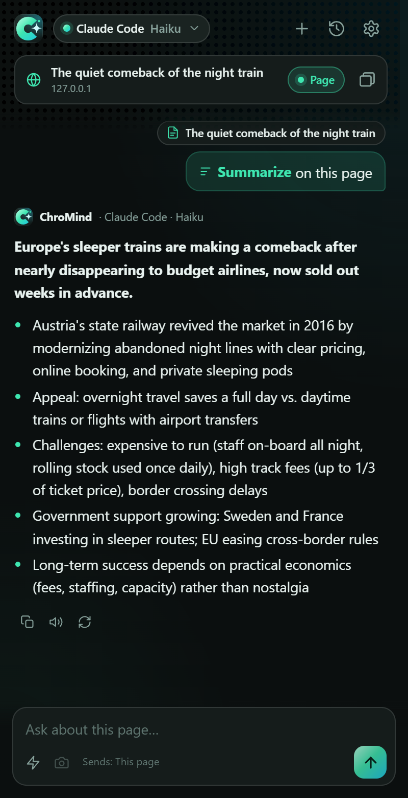

<div align="center">
  
  <h1>ChroMind</h1>
  <p>An AI side panel for Firefox and Chromium that answers with the AI you already have:<br/>
  your <b>Claude</b> login, <b>Claude Code</b> and <b>Cursor</b> through a tiny local bridge, or your own <b>Hermes Agent</b> server.</p>
  <p>
    
    
    
    
    
  </p>
  <p><a href="https://t3lluz.github.io/ChroMind/"><b>Website & docs</b></a> · <a href="https://t3lluz.github.io/ChroMind/docs/install/">Install</a> · <a href="https://t3lluz.github.io/ChroMind/docs/bridge/">Bridge</a> · <a href="https://t3lluz.github.io/ChroMind/docs/hermes/">Hermes</a></p>
  
</div>

## Features

Picked from the popular AI sidebars (Sider, Monica, Merlin, HARPA, MaxAI, the built-in browser assistants):

- **Chat with the page.** Article text via Mozilla Readability; a Page switch to leave it out. Follow-ups keep the context.
- **Quick actions and `/` commands:** summarize, key points, explain, ELI5, translate, simplify, improve writing, draft a reply, fact-check, action items, suggested questions, compare tabs, describe image. Add your own with `{{target}}` placeholders.
- **Selection toolbar:** select text → Explain / Summarize / Translate / Ask, answered in a floating card, handed off to the panel to keep chatting.
- **Right-click menus** on pages, selections, links (summarize without opening) and images.
- **YouTube:** reads the transcript; answers cite `[mm:ss]` moments you click to seek.
- **Multi-tab context, screenshots**, chat **history** with search and Markdown export, read aloud, address-bar keyword `cm`.
- **Providers:** Claude (claude.ai session), Claude Code and Cursor (via Bridge), Hermes Agent, any OpenAI-compatible server (Ollama, LM Studio, OpenRouter).
- ChroMods' glass look in mint and cyan, dark and light.

## Install

| Browser | How |
|---|---|
| Firefox, Zen, LibreWolf, Floorp | One click from [the install page](https://t3lluz.github.io/ChroMind/docs/install/#firefox) (signed by Mozilla, auto-updates) |
| Chrome, Edge, Brave, Vivaldi, Arc | Download the zip from [the install page](https://t3lluz.github.io/ChroMind/docs/install/#chrome) → `chrome://extensions` → Developer mode → Load unpacked |

From source: load `extension/` as unpacked in Chromium, or `npm run dev:firefox` / `npm run dev:zen`.

## Providers

| Provider | Uses | Setup |
|---|---|---|
| Claude | Your claude.ai login in the browser | None |
| Claude Code | `claude` CLI + your subscription | [Bridge](#bridge) |
| Cursor | `cursor-agent` CLI + your Cursor account | [Bridge](#bridge) |
| Hermes Agent | Your Hermes API server (`API_SERVER_ENABLED=true`) | URL + key ([guide](https://t3lluz.github.io/ChroMind/docs/hermes/)) |
| OpenAI-compatible | Ollama, LM Studio, OpenRouter, vLLM… | URL + model |

## Bridge

[`bridge/chromind-bridge.mjs`](bridge/chromind-bridge.mjs) is one dependency-free Node 20+ file. It serves an OpenAI-compatible API on `127.0.0.1:8765` and runs the CLIs with your logins: Claude Code with all tools off, Cursor in read-only ask mode, each in an empty scratch folder. Token-protected and closed to web pages.

```bash
node bridge/chromind-bridge.mjs            # start; prints the token for Settings → Bridge
node bridge/chromind-bridge.mjs install    # start with your computer (Windows, macOS, Linux)
```

## Development

```bash
npm install
npm test             # unit tests (node --test)
npm run test:e2e     # Playwright: loads the extension in Chromium; uses the Bridge if it's running
npm run lint:firefox # Mozilla's linter on the Firefox build
npm run pack         # dist/chromind-chrome.zip, dist/chromind-firefox-unsigned.xpi
npm run dev:site     # docs at http://localhost:4173/ChroMind/
npm run screenshots  # refresh site/assets/screens from the real extension
```

One codebase serves both browsers: `extension/manifest.json` is the Chromium manifest and `scripts/extension-files.mjs` derives Firefox's (sidebar_action, event page, gecko id, update URL). See [AGENTS.md](AGENTS.md) and the [development docs](https://t3lluz.github.io/ChroMind/docs/development/).

### Releases and Firefox signing

Pushing to `main` runs [`pages.yml`](.github/workflows/pages.yml): tests, packages, gets the Firefox build signed as an **unlisted** add-on from your AMO developer account (secrets `AMO_JWT_ISSUER` / `AMO_JWT_SECRET`, from [addons.mozilla.org/developers/addon/api/key](https://addons.mozilla.org/developers/addon/api/key/)), and deploys the docs with the downloads and Firefox's update manifest to GitHub Pages. Bump the version to ship: `npm run release -- patch`.

## Privacy

No server, no analytics. Questions and page text go only to the provider you pick; settings and chats stay in the browser. [Details](https://t3lluz.github.io/ChroMind/docs/privacy/).

## License

MIT. Includes [Mozilla Readability](https://github.com/mozilla/readability) (Apache-2.0). Sibling of [ChroMods](https://github.com/T3lluz/ChroMods).
